

<picture><source media="(prefers-color-scheme: dark)" srcset="assets/hero-dark.svg"></picture>

<picture><source media="(prefers-color-scheme: dark)" srcset="assets/about-dark.svg"></picture>

<picture><source media="(prefers-color-scheme: dark)" srcset="assets/stack-dark.svg"></picture>

<a href="https://github.com/ferdymf/Python"><picture><source media="(prefers-color-scheme: dark)" srcset="assets/project-python-dark.svg"></picture></a>&nbsp;<a href="https://github.com/ferdymf/FetchDrop"><picture><source media="(prefers-color-scheme: dark)" srcset="assets/project-fetchdrop-dark.svg"></picture></a>

<a href="https://github.com/ferdymf/Restaurant-POS-System"><picture><source media="(prefers-color-scheme: dark)" srcset="assets/project-restaurant-pos-system-dark.svg"></picture></a>&nbsp;<a href="https://github.com/ferdymf/Tiktok-Downloader"><picture><source media="(prefers-color-scheme: dark)" srcset="assets/project-tiktok-downloader-dark.svg"></picture></a>

<a href="https://github.com/ferdymf/IoT-Code"><picture><source media="(prefers-color-scheme: dark)" srcset="assets/project-iot-code-dark.svg"></picture></a>&nbsp;<a href="https://github.com/ferdymf/ferdymf"><picture><source media="(prefers-color-scheme: dark)" srcset="assets/project-ferdymf-dark.svg"></picture></a>

<picture><source media="(prefers-color-scheme: dark)" srcset="assets/stats-dark.svg"></picture>

<picture><source media="(prefers-color-scheme: dark)" srcset="assets/streak-dark.svg"></picture>

<picture><source media="(prefers-color-scheme: dark)" srcset="assets/wave-dark.svg"></picture>

<a href="https://github.com/ferdymf?tab=repositories"><picture><source media="(prefers-color-scheme: dark)" srcset="assets/button-1-dark.svg"></picture></a>&nbsp;&nbsp;<a href="https://github.com/ferdymf?tab=repositories"><picture><source media="(prefers-color-scheme: dark)" srcset="assets/button-2-dark.svg"></picture></a>

<a href="https://metawka.github.io/expressive-profile/?from=ferdymf"><picture><source media="(prefers-color-scheme: dark)" srcset="assets/credit-dark.svg"></picture></a>

